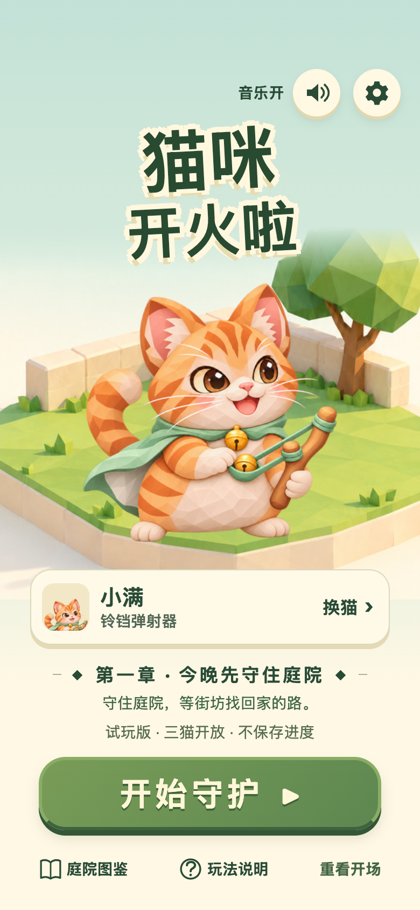
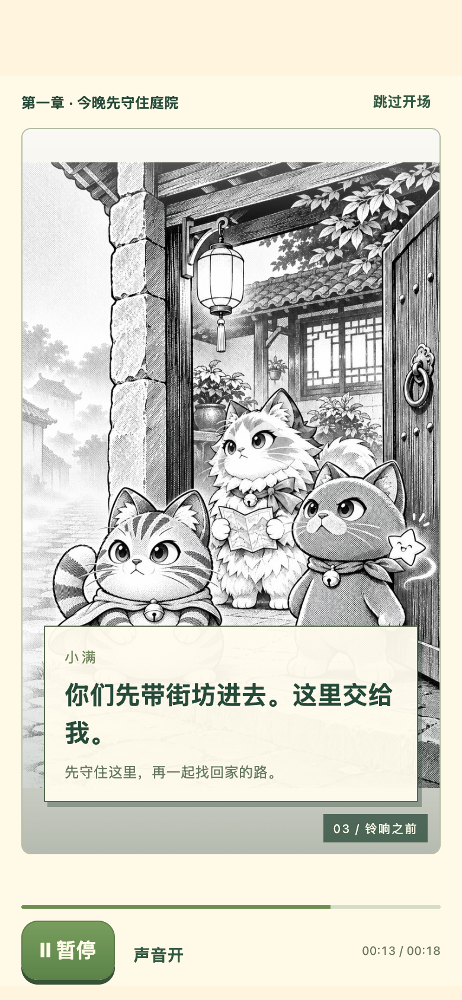
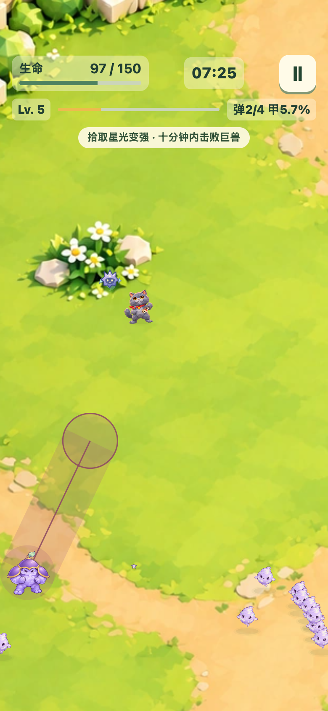
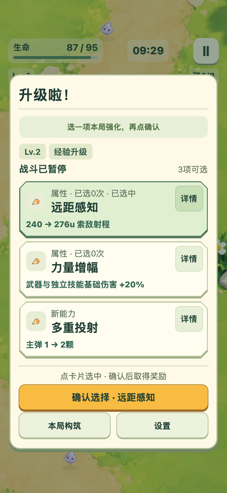

# 猫咪开火啦（MeowShooter）

圆润可爱的 2D 猫咪生存射击小游戏：单指走位、自动开火，拾取星光升级，每局拼出不同的构筑，在十分钟内守住庭院、击败巨兽。

  
  
  
  

## 故事

鱼摊阿婆还记得给小满多放一条鱼，却认不出自己写的字。入夜，雾气追到庭院，巨兽随之而来，而院门后面，还有等大家回家的灯。

小满、听雪和乌舟决定先守住这里，天亮了，再一起找回家的路。

第一章以 18 秒的配乐动态漫画开场，首次通关后还有 24 秒的尾声。

## 玩法

- **单指走位，自动开火**：在屏幕任意位置按住拖动即可移动；攻击自动瞄准最近的敌人，弹匣打空自动装填。电脑上用 WASD 或按住鼠标拖动。
- **十分钟守庭院**：怪群越来越密，精英怪中途来袭；最终 Boss「雾壳巨兽」会冲锋、拍地、散射雾核。十分钟内击败巨兽即可通关。
- **升级三选一**：击退怪物会掉落星光，攒够就升级，每次从三项奖励中选一项。50 项奖励涵盖属性、核心能力、配件、进阶融合与取舍契约，每局组合都不一样。
- **精英战利品**：击败精英额外获得一次奖励选择，并回复生命。

## 三只猫

| 猫咪 | 特点 | 短板 | 固定武器 |
|---|---|---|---|
| 小满（美短） | 机动灵活；装填后的第一轮齐射多一颗副弹 | 生命稍低 | 铃铛弹射器：射速快，弹匣大 |
| 听雪（布偶） | 冰霜控场：寒意叠满会冻住普通敌人 | 主武器直接伤害稍低 | 小鱼干飞镖：单发伤害高，可穿透 |
| 乌舟（英短） | 生存容错高；开局自带星灵伙伴协同攻击 | 移速稍低 | 鱼骨散射炮：近距离一次散射五颗鱼骨 |

## 技术

- 基于 Phaser 3 与 TypeScript：战斗在 Phaser Canvas 中运行，使用 Arcade 物理；页面和弹层用 DOM/CSS。
- 音乐和音效全部由代码乐谱在运行时合成，游戏包里没有音频文件。
- 面向小红书离线小工具：图片以 WebP 为主，离线包控制在 3.5 MiB 以内。

## 版权

版权所有，保留一切权利，详见 [LICENSE](LICENSE)。`app/src/audio/vendor/` 中的第三方代码适用其各自的许可证。
